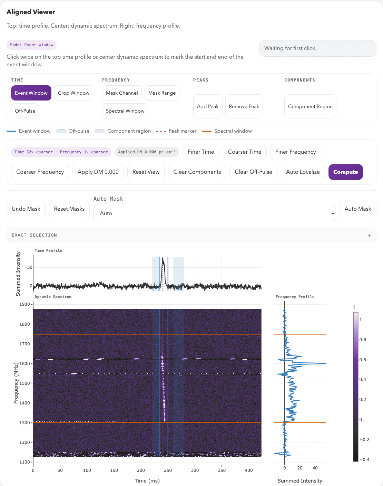

# FLITS

[](https://dirkkuiper.github.io/flits/)
[](https://doi.org/10.5281/zenodo.23596340)
[](https://pypi.org/project/flits/)
[](https://pypi.org/project/flits/)
[](https://github.com/DirkKuiper/flits/actions/workflows/tests.yml)
[](https://pypi.org/project/flits/)
[](https://github.com/DirkKuiper/flits/blob/main/LICENSE)

Fast-Look Interactive Transient Suite.

FLITS is browser-based FRB analysis software for interactive burst
inspection, masking, measurement, DM optimization, temporal/spectral
diagnostics, and export. It reads SIGPROC filterbank (`.fil`),
PSRFITS search/fold data (`.fits`, `.sf`), and CHIME/FRB HDF5 (`.h5`, `.hdf5`)
including public catalog waterfalls and beamformed `BBData`
`tiedbeam_power` files. The I/O layer is pluggable — third parties can
register custom formats via `importlib` entry points without forking.

The same measurements are available without a browser: `flits measure` runs
masking, burst localization, and measurement over one file or many and writes
JSON or CSV, and the `BurstSession` Python API exposes every step the interface
offers. The selected analysis state is recorded in a JSON session snapshot.
Given the snapshot and original data, `flits replay` restores the selections
and recomputes supported measurements.



The [guided GBT workflow](https://dirkkuiper.github.io/flits/guided-workflow/)
walks through the selections and results shown in the interface.

## Why FLITS exists

Measuring a detected burst involves selecting an event window and noise
reference, masking interference, choosing a frequency range, and refining the
dispersion measure (DM). These choices affect the resulting measurements and
must be preserved to interpret and reproduce them.

FLITS was built for a repeater campaign spanning GBT at L and P band, Nançay,
Westerbork, Onsala, Stockert, and CHIME. A common reader interface and configurable
telescope presets support analysis across their formats and calibration
conventions. The session retains the selected state so collaborators can
reopen it and recompute supported measurements from the original data.
Snapshots and exports record software versions and available source identities
for each analysis, preserving the origins of older results during partial
recomputation. Historical files without this information remain explicitly
unattributed. See the [preservation guide](https://dirkkuiper.github.io/flits/user-guide/exports-and-snapshots/)
for environment archiving and compatibility limits.

FLITS builds on specialist search, data-processing, and analysis packages. It
connects measurements through a shared session model with explicit calibration
and uncertainty metadata. Flux and fluence estimates without a supplied SEFD
uncertainty are flagged as having an incomplete uncertainty budget.

FLITS is not a search pipeline — it starts from a burst you already have.

## Quick Start

Install the published package and open a prepared example burst:

```bash
pip install flits
flits demo
```

`flits demo` downloads the public GBT burst from the
[guided workflow](https://dirkkuiper.github.io/flits/guided-workflow/) once
(42 MB, checksum-verified) and opens it in your browser with the guide's
selections and measurements in place.

To work on your own data:

```bash
flits --data-dir /path/to/filterbanks --host 127.0.0.1 --port 8123
```

Then open `http://127.0.0.1:8123`.

## Scripting and batch measurement

Measure bursts from the command line: mask interference, localize the burst,
and measure it, for one file or many:

```bash
flits measure burst.fil --dm 527.7                 # JSON on stdout
flits measure data/*.fil --dm 527.7 --format csv --output results.csv \
  --snapshot-dir data/snapshots                    # one session per burst
```

Pin any choice instead of automating it with `--event`, `--offpulse`, `--band`,
or `--crop`. Each saved session can be opened in the interface for review or
checked with `flits replay --check`. See
[Headless Measurement](https://dirkkuiper.github.io/flits/user-guide/headless-measurement/).

From Python, every step the interface offers is a method on `BurstSession`:

```python
from flits import BurstSession

session = BurstSession.from_file("burst.fil", dm=527.7, sefd_jy=10.0)
session.auto_mask()
session.auto_localize()
measurements = session.compute_properties()
print(measurements.snr_integrated, measurements.fluence_jyms)
```

`flits.measure_burst` does the same in one call and returns the record that
`flits measure` prints. See the
[Python API](https://dirkkuiper.github.io/flits/developer/api-reference/).

### With a coding agent

The FLITS skill helps Codex, Claude Code, Cursor and Copilot select the existing
analysis routines and check their results. In Codex:

```text
Use $skill-installer to install frb-analysis from
https://github.com/DirkKuiper/flits/tree/main/plugins/flits/skills/frb-analysis
```

In Claude Code:

```text
/plugin marketplace add DirkKuiper/flits
/plugin install flits@flits
```

The skill follows the [Agent Skills](https://agentskills.io) standard. See
[Coding Agents](https://dirkkuiper.github.io/flits/user-guide/coding-agents/)
for Cursor and Copilot installation, project-local skills, and verifying that
the agent can find FLITS and access your data.

## Highlights

- Browser-based workflow for burst inspection on SIGPROC, PSRFITS, and CHIME/FRB HDF5 data.
- Headless `flits measure` command and `BurstSession` Python API for scripted and batch measurement, with JSON, JSONL, and CSV output.
- CHIME support includes public catalog waterfalls and beamformed `BBData` power products.
- Interactive crop, event, off-pulse, spectral-window, and masking controls.
- Automatic burst localization in time and frequency (matched-filter event window, spectral extent, and off-pulse placement in one click).
- Calibrated fluence and peak-flux outputs when an SEFD is available.
- DM optimization using integrated-event S/N and DMphase.
- Temporal-structure, PSD, ACF, and selected-event fits of the fitburst burst model.
- Sub-burst drift rate in MHz/ms from the mask-corrected 2D autocorrelation, cross-checked against a component-centroid regression, with the drift/DM degeneracy reported as the DM offset that would account for the measured slope.
- Weighted Q/U RM synthesis with optional RM-CLEAN, significance and quality diagnostics, and JSON/CSV products — measured in-session from a full-Stokes burst file, or from an externally prepared Q/U spectrum.
- Export bundles and JSON session snapshots for reproducible analysis.

## Documentation

- Full docs: [dirkkuiper.github.io/flits](https://dirkkuiper.github.io/flits/)
- Getting started: [Quickstart](https://dirkkuiper.github.io/flits/getting-started/)
- Guided example: [GBT Burst Workflow](https://dirkkuiper.github.io/flits/guided-workflow/)
- Scripting: [Headless Measurement](https://dirkkuiper.github.io/flits/user-guide/headless-measurement/) and [Python API](https://dirkkuiper.github.io/flits/developer/api-reference/)
- For language-model tools: [llms.txt](https://dirkkuiper.github.io/flits/llms.txt) and [llms-full.txt](https://dirkkuiper.github.io/flits/llms-full.txt); coding agents working in this repository should read [AGENTS.md](https://github.com/DirkKuiper/flits/blob/main/AGENTS.md)
- Installation and deployment: [Installation](https://dirkkuiper.github.io/flits/installation/)
- Developer testing: [Testing](https://dirkkuiper.github.io/flits/developer/testing/)
- Developer publishing: [Publishing](https://dirkkuiper.github.io/flits/developer/publishing/)

The docs cover Python installs, Docker, Apptainer, remote/HPC use, interactive
workflow guidance, measurements, DM optimization, temporal/spectral analysis,
sub-burst drift, exports, and release procedures.

## Release Channels

- PyPI and `ghcr.io/dirkkuiper/flits:latest` track stable releases.
- `ghcr.io/dirkkuiper/flits:<version>` pins an exact release.
- `ghcr.io/dirkkuiper/flits:edge` tracks the current `main` branch for snapshot testing.

## Citation

If you use FLITS in research, please cite the software archive on Zenodo:
[doi:10.5281/zenodo.23596340](https://doi.org/10.5281/zenodo.23596340). That
DOI always resolves to the latest release; each release also has its own DOI,
listed on the Zenodo page, for citing the exact version you used.

Author and citation metadata are in
[CITATION.cff](https://github.com/DirkKuiper/flits/blob/main/CITATION.cff),
which GitHub's "Cite this repository" button turns into APA or BibTeX.

## License

FLITS is released under the GNU GPLv3. See [LICENSE](./LICENSE).

The interface bundles [plotly.js](https://github.com/plotly/plotly.js) (MIT) so
it works without fetching anything from a CDN; its licence travels with the copy
in [`flits/web_static/vendor/`](./flits/web_static/vendor/).
