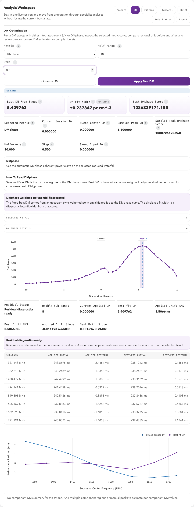

# DM Optimization

FLITS sweeps trial DMs around the current value, scores each one, and reports
the DM that maximizes the chosen criterion. Four criteria are available, and
they answer different questions. The smoothed-structure metric also reports a
range of DMs derived from the noise; the others report the width of their
fitted score peak.

## How dedispersion works here

FLITS dedisperses incoherently to the top of the band. The delay of a channel at
frequency \( \nu \) relative to the reference frequency \( \nu_\mathrm{ref} \)
(the highest channel) is

$$
\Delta t = k_\mathrm{DM} \, \mathrm{DM} \left( \nu_\mathrm{ref}^{-2} - \nu^{-2} \right),
\qquad k_\mathrm{DM} = \frac{1}{2.41 \times 10^{-4}}\ \mathrm{MHz^2\,pc^{-1}\,cm^{3}\,s}
$$

using the pulsar-astronomy convention for \( k_\mathrm{DM} \) rather than the
exact physical constant — see [References](../references.md).

Each channel is shifted by **a whole number of samples**. Two consequences
follow, and both matter when choosing sweep parameters.

### The DM resolution is set by the time resolution

Because shifts are rounded, there is a smallest DM step that moves anything at
all: the step that shifts the lowest channel by one sample,

$$
\delta_\mathrm{DM} = \frac{t_\mathrm{samp}}
{k_\mathrm{DM} \left| \nu_\mathrm{ref}^{-2} - \nu_\mathrm{low}^{-2} \right|}
$$

Trials spaced more finely than this are **bit-identical**. A sweep stepped below
it wastes work and produces a score curve that looks smooth because neighbouring
points are the same data, not because the metric is well behaved.

`flits.signal.dedispersion_bin_resolution` computes this for a given band and
sampling. Use it to pick a step rather than guessing:

```python
from flits.signal import dedispersion_bin_resolution

step = dedispersion_bin_resolution(session.freqs, session.tsamp)
session.optimize_dm(session.dm, half_range=2.0, step=step)
```

Results are tagged with an `integer_bin_dedispersion` warning flag as a
reminder that the reported DM cannot be more precise than this.

### The window edges are not valid data

Samples shifted in from beyond the read window are not burst data. FLITS
zero-fills them when a file is loaded, rather than wrapping them around the time
axis where they would contaminate the off-pulse region. The affected extent is
reported by `flits.signal.dedispersion_edge_bins`. Keep the event and off-pulse
windows away from it; burst localization raises `event_near_edge` when the burst
sits too close.

## The metrics

### Integrated-event S/N

Sums the dynamic spectrum over the spectral window to a profile, integrates the
event window, and divides by the noise estimated from the off-pulse regions. The
DM that maximizes this is the DM that makes the burst brightest and narrowest in
the summed profile.

Use it when the burst is a single smooth component, and when signal-to-noise
rather than structure is what you have to work with.

It is biased for bursts with downward frequency drift: a drifting burst is
brightest when the drift is partly absorbed into the dispersion sweep, so the
S/N-maximizing DM is systematically higher than the true one.

Its score is a sum over a fixed event window, and changing the DM only moves
signal around inside that window. The score changes as signal crosses the
window's edges. A wide window therefore flattens the curve, and a window that
is not centred on the burst can pull the peak towards one side. For an S/N
criterion that follows the smearing itself, use peak S/N.

### Structure maximization (DMphase)

A clean-room implementation of the DM\_phase algorithm. Rather than maximizing
brightness, it maximizes the *coherence of the burst's Fourier phases across the
band*: at the correct DM, structure in different channels lines up in time, and
the phases of the corresponding Fourier components agree.

Use it when the burst has sharp sub-structure, and whenever drift would bias the
S/N metric. This is the criterion generally preferred for repeaters — see
Hessels et al. (2019) in the [References](../references.md).

It needs structure to work with. On a smooth, low-S/N burst the phase coherence
is weak and the score curve is correspondingly flat; the reported fit status
will say so.

### Smoothed structure (Sutinjo et al. 2023)

A clean-room implementation of the method of Sutinjo et al. (2023). For each
trial DM, FLITS sums the selected, unmasked channels over the event window into
a light curve, smooths it with a low-pass filter in the discrete cosine
transform (DCT) domain, and scores it by the 2-norm of the smoothed curve's
derivative: the sharper the aligned burst, the higher the score.

Because the score is a norm, the noise left over after smoothing bounds how much
it can change. Every trial whose score, raised by that noise allowance, still
reaches the best score cannot be distinguished from the best DM (their eq. 15).
Those trials span the reported **consistent DM range**.

Use it when you need a DM range to quote. It also gives an independent check on
DMphase: the two use different statistics, so agreement between them is
reassuring.

**How wide the range is.** FLITS tested it on simulated bursts with a known
DM, rendered with sub-sample dispersion and swept with FLITS's own
dedispersion. Across single and multi-component bursts at several S/N levels,
the range contained the true DM in 98–100% of cases, and its half-width was
about 4 to 7 times the rms error of the best DM. It is a conservative range of
consistent DMs: quote it as a range, citing the method. It is labelled "range"
(`conservative_bound`) in the uncertainty detail and the export; the plain
`best_dm_uncertainty` field holds 1σ errors only, so it stays empty. See
[Uncertainties](../user-guide/uncertainties.md).

**The cutoff k<sub>c</sub>** sets how much of the light curve's DCT spectrum
counts as signal. Left blank, FLITS picks it where the spectrum falls to its
noise floor (the mean of its upper half). Sutinjo et al. recommend checking
this against the spectrum, which is stored as `dct_envelope` in the result. In
the simulations the automatic choice gave both the most accurate best DM and
the narrowest range: halving k<sub>c</sub> or doubling it made both worse,
doubling much worse. Set it by hand only when the spectrum shows a clearer
break.

On the [GBT guided workflow](../guided-workflow.md) burst, with the guide's
selections and a 0.5 step, the metric gives a best residual DM of 5.0 and a
consistent range of 4.0 to 6.0. That brackets the DMphase value of 5.41.

Requirements and caveats:

- The event window must hold at least 16 time samples at the analysis
  resolution, so the DCT spectrum has a noise region to judge the cutoff from.
- Keep the event window close around the burst. Including long stretches of
  off-pulse data adds noise without structure and widens the range; with a low
  cutoff it can stretch the range to the edge of the sweep.
- The best DM is the best sampled trial, and the range ends on sampled trials,
  so the step sets their resolution. If only the best trial passes, FLITS
  reports one step as the range half-width and flags
  `structure_interval_within_one_step`. Use a step at or above the DM bin
  resolution described above.
- If the range reaches the end of the sweep (`structure_interval_on_sweep_edge`),
  the true range extends beyond it: widen the sweep. If it has gaps
  (`structure_interval_has_gaps`), the score curve has more than one acceptable
  region: inspect the curve.

### Peak S/N (Gaussian fit)

This follows Ould-Boukattine et al. (2026), who take each burst's DM as the
centre of a Gaussian fitted to its peak S/N against trial DM. They dedisperse
baseband data coherently; FLITS dedisperses the filterbank incoherently, so
smearing within each channel stays in the data.

For each trial DM, FLITS sums the selected, unmasked channels into a profile in
off-pulse noise units and takes its highest S/N inside the event window. A wrong
DM smears the burst in time and lowers that peak. FLITS then fits a Gaussian plus
a constant to every trial:

$$
\mathrm{S/N}(\mathrm{DM}) = A \exp\left[-\frac{(\mathrm{DM} - \mathrm{DM}_0)^2}{2\sigma^2}\right] + C
$$

The centre \( \mathrm{DM}_0 \) is the best DM. The width \( \sigma \) is reported
as its uncertainty, labelled "fit width" (`heuristic_local_fit`). The fitted
parameters are stored in the result's `gaussian_fit` record, and the interface
draws the fitted curve dashed over the sweep.

`peak_snr_filter` chooses how the peak is found:

- **`peak_bin`** (the default) takes the highest S/N of a window one analysis
  sample long. Smearing lowers it fastest, so it gives the most precise best DM
  for bright, narrow bursts. It needs the burst to stand out at the analysis
  resolution; choose that resolution with the time downsampling, as for any
  profile.
- **`boxcar`** also smooths the profile with boxcars from one sample up to the
  event window's length and keeps the highest S/N, like a search pipeline's
  matched filter. It finds faint or wide bursts that single samples miss. Its
  curve is flatter, because a wider boxcar recovers part of the smeared signal.
  The boxcar width that won at each trial is stored in
  `gaussian_fit.matched_width_ms`.

Both filters slide their windows along the native samples instead of reading
the downsampled analysis grid. On a fixed grid the peak also depends on whether
the burst falls inside one sample or across two, and changing the DM moves the
burst in time. At 8× downsampling that made the fit depend on where the burst
happened to sit: for one simulated burst moved by a few native samples, σ
ranged from 0.7 to 3.2, and on a narrow sweep the curve split into two humps
around the true DM. With sliding windows σ varied by under 15%.

```python
result = session.optimize_dm(session.dm, half_range=2.0, step=step, metric="peak_snr", peak_snr_filter="boxcar")
result.best_dm, result.gaussian_fit.sigma_dm
```

**What \( \sigma \) is.** It measures how quickly the peak S/N falls as the DM
moves away from the best value. That rate is set by the burst's width, the band
and the time resolution, so \( \sigma \) does not shrink as the burst gets
brighter, while the scatter of the best DM does. FLITS tested this on simulated
bursts with a known DM, rendered with sub-sample dispersion (1100–1500 MHz, 64
channels, 0.1 ms samples) and swept over ±40 trials at the DM bin resolution,
80 bursts per row:

| Burst | Peak S/N (peak bin / boxcar) | rms error of the best DM, in trial steps (peak bin / boxcar) | \( \sigma \) contained the true DM (peak bin / boxcar) |
| --- | --- | --- | --- |
| 0.3 ms, faint | 3.5 / 5.1 | 15 / 11 | 76% / 93% |
| 0.3 ms, moderate | 5.5 / 10 | 1.9 / 2.8 | 100% / 100% |
| 0.3 ms, bright | 9.9 / 20 | 1.0 / 1.4 | 100% / 100% |
| 1 ms, faint | 4.9 / 13 | 8.4 / 6.9 | 91% / 96% |

For the moderate and bright bursts \( \sigma \) contained the true DM every
time; for the faint ones, in 91–96% of cases. It was 1 to 4 times the rms error
of the best DM for faint bursts and 5 to 10 times for bright ones. The
exception is the peak-bin filter on the faintest 0.3 ms bursts (76%), whose
single samples barely rise above the noise; the boxcar still found them.

The result also gives `snr_drop_one_half_width`: the distance from the best DM
at which the fitted S/N has fallen by 1. Unlike \( \sigma \), it narrows as
the burst gets brighter. In the same simulations it contained the true DM every
time for the moderate and bright bursts. For the faint ones it did so in
86–96% of cases with the boxcar, but in only 33–62% with the peak bin.

FLITS does not report the fit's own covariance error on \( \mathrm{DM}_0 \).
Neighbouring trials share the same noise, so that error is far too small: in a
first version of these simulations it contained the true DM in only 8–30% of
cases.

Requirements and caveats:

- Sweep a few \( \sigma \) either side of the peak, and no further. Far from
  the peak the S/N falls more slowly than a Gaussian, and every trial counts in
  the fit, so a sweep much wider than the peak lets its shoulders widen
  \( \sigma \) and pull the centre. On the synthetic test burst (DM 0, 1 ms
  samples), a ±24 sweep gives a best DM of −1 and \( \sigma \approx 7 \); a ±60
  sweep gives −6 to −15 and \( \sigma \) of 30 to 40. A large fit residual
  compared with the curve's depth is the sign: narrow the half-range and run
  the sweep again. (Fitting only the trials around the peak was tried and
  rejected: on faint simulated bursts the noise then set the width.)
- Sweep far enough that the S/N falls clearly on both sides. If the fitted
  \( \sigma \) is more than half the sweep, `gaussian_width_exceeds_sweep` is
  flagged: \( \sigma \) and the constant then trade off, so widen the
  half-range.
- If the fitted centre lies within one step of either end
  (`gaussian_center_on_sweep_edge`), the far side of the peak was not sampled:
  re-centre the sweep.
- If \( \sigma \) is smaller than the step (`gaussian_width_below_step`), only
  a few trials define the peak: use a smaller step, but no smaller than the DM
  bin resolution.
- Near the bin resolution, the integer-sample shifts make the curve jagged.
  Fitting every trial averages over that.
- If no Gaussian can be fitted (`gaussian_fit_failed`, `gaussian_fit_flat_curve`,
  `gaussian_fit_insufficient_trials`), the best sampled trial is reported
  without a width.

## What the sweep depends on

The optimization runs against the current session state, not the raw file:

- the dynamic spectrum at the current DM
- the crop and event window
- the spectral window
- the channel mask
- the reduced-resolution (decimation) state

Changing any of them can change the preferred DM. This is a feature — masking a
band of interference genuinely changes which DM best aligns what remains — but
it means a reported DM is only meaningful alongside the state that produced it.
That state is what the session snapshot records.

## Reading the result



*The DMphase curve peaks near a residual DM of 5.5 on the sampled grid; the
weighted fit reports about 5.41. The lower plot compares sub-band arrival-time
residuals at the applied and fitted DMs. See the [GBT guided workflow](../guided-workflow.md)
for the inputs and interpretation limits of this example.*

| Output | What to look at |
| --- | --- |
| Score curve | Should have a clear single maximum. Multiple comparable peaks mean the metric cannot distinguish them. |
| Preferred DM and fit status | A parabolic fit near the peak; `peak_on_sweep_edge` means the true optimum is outside the range you swept. |
| Residual arrival time | Structure remaining across the band after dedispersion, at both the applied and optimized DMs. |
| Consistent DM range | Smoothed structure only: the DMs whose score plus noise allowance (dotted curve) reaches the best score (dashed line), shaded on the plot. A conservative range. |
| Gaussian fit | Peak S/N only: the fitted curve (dashed), with \( \sigma \) shaded around the best DM, and how the peak was found (peak bin or boxcar). |
| Warning flags | `integer_bin_dedispersion` always; others as they arise. |

## Practical guidance

1. Mask bad channels first — interference dominates the score otherwise.
2. Restrict the spectral window to the part of the band you trust.
3. Set a sensible event window; the S/N metric integrates exactly what you give it.
4. Choose a step at or above the bin resolution above.
5. If the peak sits at the edge of the sweep, widen the range and re-run.
6. Pick the metric that suits the burst: structure maximization when there is
   structure or drift, peak S/N or integrated S/N when there is not. Use
   smoothed structure when you need a DM range to quote, and compare it with
   DMphase.
7. Treat the result as local to the analysis state, not as a context-free value.
