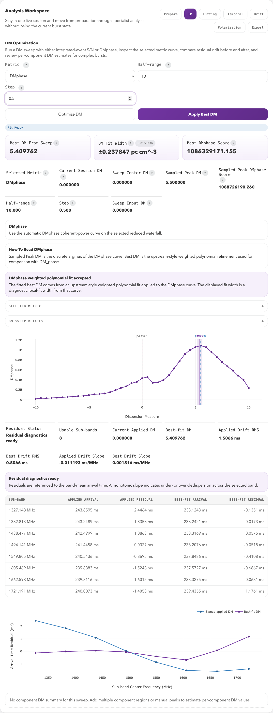

# DM Optimization

FLITS sweeps trial DMs around the current value, scores each one, and reports
the DM that maximizes the chosen criterion. Three criteria are available, and
they answer different questions. Only the smoothed-structure metric also
reports a DM range derived from the noise; the others report a heuristic fit
width.

## How dedispersion works here

FLITS dedisperses incoherently to the top of the band. The delay of a channel at
frequency \( \nu \) relative to the reference frequency \( \nu_\mathrm{ref} \)
(the highest channel) is

$$
\Delta t = k_\mathrm{DM} \, \mathrm{DM} \left( \nu_\mathrm{ref}^{-2} - \nu^{-2} \right),
\qquad k_\mathrm{DM} = \frac{1}{2.41 \times 10^{-4}}\ \mathrm{MHz^2\,pc^{-1}\,cm^{3}\,s}
$$

using the pulsar-astronomy convention for \( k_\mathrm{DM} \) rather than the
exact physical constant — see [References](../references.md).

Each channel is shifted by **a whole number of samples**. Two consequences
follow, and both matter when choosing sweep parameters.

### The DM resolution is set by the time resolution

Because shifts are rounded, there is a smallest DM step that moves anything at
all: the step that shifts the lowest channel by one sample,

$$
\delta_\mathrm{DM} = \frac{t_\mathrm{samp}}
{k_\mathrm{DM} \left| \nu_\mathrm{ref}^{-2} - \nu_\mathrm{low}^{-2} \right|}
$$

Trials spaced more finely than this are **bit-identical**. A sweep stepped below
it wastes work and produces a score curve that looks smooth because neighbouring
points are the same data, not because the metric is well behaved.

`flits.signal.dedispersion_bin_resolution` computes this for a given band and
sampling. Use it to pick a step rather than guessing:

```python
from flits.signal import dedispersion_bin_resolution

step = dedispersion_bin_resolution(session.freqs, session.tsamp)
session.optimize_dm(session.dm, half_range=2.0, step=step)
```

Results are tagged with an `integer_bin_dedispersion` warning flag as a
reminder that the reported DM cannot be more precise than this.

### The window edges are not valid data

Samples shifted in from beyond the read window are not burst data. FLITS
zero-fills them when a file is loaded, rather than wrapping them around the time
axis where they would contaminate the off-pulse region. The affected extent is
reported by `flits.signal.dedispersion_edge_bins`. Keep the event and off-pulse
windows away from it; burst localization raises `event_near_edge` when the burst
sits too close.

## The metrics

### Integrated-event S/N

Sums the dynamic spectrum over the spectral window to a profile, integrates the
event window, and divides by the noise estimated from the off-pulse regions. The
DM that maximizes this is the DM that makes the burst brightest and narrowest in
the summed profile.

Use it when the burst is a single smooth component, and when signal-to-noise
rather than structure is what you have to work with.

It is biased for bursts with downward frequency drift: a drifting burst is
brightest when the drift is partly absorbed into the dispersion sweep, so the
S/N-maximizing DM is systematically higher than the true one.

### Structure maximization (DMphase)

A clean-room implementation of the DM\_phase algorithm. Rather than maximizing
brightness, it maximizes the *coherence of the burst's Fourier phases across the
band*: at the correct DM, structure in different channels lines up in time, and
the phases of the corresponding Fourier components agree.

Use it when the burst has sharp sub-structure, and whenever drift would bias the
S/N metric. This is the criterion generally preferred for repeaters — see
Hessels et al. (2019) in the [References](../references.md).

It needs structure to work with. On a smooth, low-S/N burst the phase coherence
is weak and the score curve is correspondingly flat; the reported fit status
will say so.

### Smoothed structure (Sutinjo et al. 2023)

A clean-room implementation of the method of Sutinjo et al. (2023). For each
trial DM, FLITS sums the selected, unmasked channels over the event window into
a light curve, smooths it with a low-pass filter in the discrete cosine
transform (DCT) domain, and scores it by the 2-norm of the smoothed curve's
derivative: the sharper the aligned burst, the higher the score.

Because the score is a norm, the noise left over after smoothing bounds how much
it can change. Every trial whose score, raised by that noise allowance, still
reaches the best score cannot be distinguished from the best DM (their eq. 15).
Those trials span the reported **consistent DM range**.

Use it when you need a DM range to quote. It also gives an independent check on
DMphase: the two use different statistics, so agreement between them is
reassuring.

**The range is a conservative bound, not a 1-sigma error.** FLITS tested it on
simulated bursts with a known DM, rendered with sub-sample dispersion and swept
with FLITS's own dedispersion. Across single and multi-component bursts at
several S/N levels, the range contained the true DM in 98–100% of cases, and
its half-width was about 4 to 7 times the rms error of the best DM. Quote it as
a range of consistent DMs, citing the method, and not as ± 1σ. FLITS classifies
it as `conservative_bound`, so it is never exported as the scalar 1-sigma
`best_dm_uncertainty`.

**The cutoff k<sub>c</sub>** sets how much of the light curve's DCT spectrum
counts as signal. Left blank, FLITS picks it where the spectrum falls to its
noise floor (the mean of its upper half). Sutinjo et al. recommend checking
this against the spectrum, which is stored as `dct_envelope` in the result. In
the simulations the automatic choice gave both the most accurate best DM and
the narrowest range: halving k<sub>c</sub> or doubling it made both worse,
doubling much worse. Set it by hand only when the spectrum shows a clearer
break.

On the [GBT guided workflow](../guided-workflow.md) burst, with the guide's
selections and a 0.5 step, the metric gives a best residual DM of 5.0 and a
consistent range of 4.0 to 6.0. That brackets the DMphase value of 5.41.

Requirements and caveats:

- The event window must hold at least 16 time samples at the analysis
  resolution, so the DCT spectrum has a noise region to judge the cutoff from.
- Keep the event window close around the burst. Including long stretches of
  off-pulse data adds noise without structure and widens the range; with a low
  cutoff it can stretch the range to the edge of the sweep.
- The best DM is the best sampled trial, and the range ends on sampled trials,
  so the step sets their resolution. If only the best trial passes, FLITS
  reports one step as the range half-width and flags
  `structure_interval_within_one_step`. Use a step at or above the DM bin
  resolution described above.
- If the range reaches the end of the sweep (`structure_interval_on_sweep_edge`)
  or has gaps (`structure_interval_has_gaps`), it is not marked publishable.
  Widen the sweep, or inspect the curve.

## What the sweep depends on

The optimization runs against the current session state, not the raw file:

- the dynamic spectrum at the current DM
- the crop and event window
- the spectral window
- the channel mask
- the reduced-resolution (decimation) state

Changing any of them can change the preferred DM. This is a feature — masking a
band of interference genuinely changes which DM best aligns what remains — but
it means a reported DM is only meaningful alongside the state that produced it.
That state is what the session snapshot records.

## Reading the result



*The DMphase curve peaks near a residual DM of 5.5 on the sampled grid; the
weighted fit reports about 5.41. The lower plot compares sub-band arrival-time
residuals at the applied and fitted DMs. See the [GBT guided workflow](../guided-workflow.md)
for the inputs and interpretation limits of this example.*

| Output | What to look at |
| --- | --- |
| Score curve | Should have a clear single maximum. Multiple comparable peaks mean the metric cannot distinguish them. |
| Preferred DM and fit status | A parabolic fit near the peak; `peak_on_sweep_edge` means the true optimum is outside the range you swept. |
| Residual arrival time | Structure remaining across the band after dedispersion, at both the applied and optimized DMs. |
| Consistent DM range | Smoothed structure only: the DMs whose score plus noise allowance (dotted curve) reaches the best score (dashed line), shaded on the plot. A conservative bound, not a 1-sigma error. |
| Warning flags | `integer_bin_dedispersion` always; others as they arise. |

## Practical guidance

1. Mask bad channels first — interference dominates the score otherwise.
2. Restrict the spectral window to the part of the band you trust.
3. Set a sensible event window; the S/N metric integrates exactly what you give it.
4. Choose a step at or above the bin resolution above.
5. If the peak sits at the edge of the sweep, widen the range and re-run.
6. Pick the metric that suits the burst: structure maximization when there is
   structure or drift, integrated S/N when there is not. Use smoothed structure
   when you need a DM range to quote, and compare it with DMphase.
7. Treat the result as local to the analysis state, not as a context-free value.
