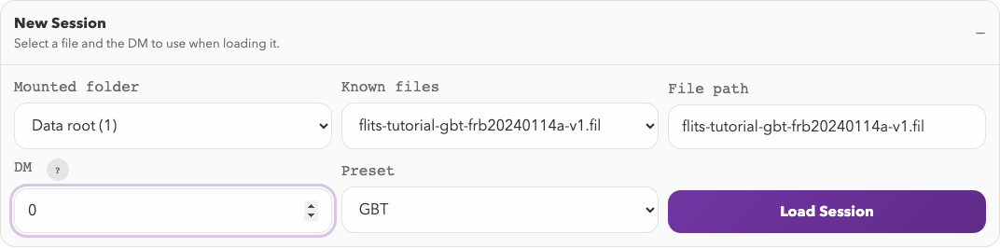

# Quickstart

This page is the shortest path from install to a working FLITS session.

## 1. Install FLITS

```bash
pip install flits
```

## 2. Try the demo

To see FLITS on a real burst before using your own data:

```bash
flits demo
```

The first run downloads the public GBT burst from the
[Guided Workflow](guided-workflow.md) (42 MB, checked against its published
SHA-256) into `~/.cache/flits/demo`. FLITS then opens it in your browser with
the guide's selections and measurements already in place, so you can explore a
finished session first. Later runs reuse the file and work offline.

Over SSH, add `--no-browser` and open the printed link through a port forward.
Use `--dir DIR` to keep the demo somewhere else, or to point it at a copy you
downloaded by hand. Use `--reset` to discard changes you saved to the demo
session.

## 3. Start the local server

Point FLITS at a directory containing your filterbanks:

```bash
flits --data-dir /path/to/filterbanks --host 127.0.0.1 --port 8123
```

Open `http://127.0.0.1:8123`.

The browser opens with a **New Session** form. Choose the source file and DM
there, then use **Load Session**. The **Session** panel in the left sidebar is
for saving or reopening a session after it has loaded.

## 4. Load a burst file

FLITS reads SIGPROC filterbank (`.fil`), PSRFITS search/fold data (`.fits`,
`.sf`), and CHIME/FRB HDF5 (`.h5`, `.hdf5`) files, including CHIME public
catalog waterfalls and beamformed `BBData` power files. See
[Supported Formats](user-guide/supported-formats.md) for the full matrix.

Inside the UI:

1. Pick a file from the directory list or type a path manually.
2. Enter the burst DM.
   For CHIME catalog waterfalls FLITS will suggest `0`, and for CHIME
   beamformed `BBData` files it will suggest the file's `DM_coherent`.
3. Adjust telescope/preset settings if the detected preset is not what you want.
4. Load the session.

If FLITS can identify the observing setup, it may populate default calibration
values such as SEFD. If it cannot, use the generic preset or set an explicit
SEFD yourself.



*The New Session form for the [GBT example](guided-workflow.md). For your own
data, choose your file and its appropriate DM before loading.*

## 5. Work through the session

The typical order is:

1. Prepare the crop, event window, off-pulse window, spectral window, and mask.
2. Compute measurements.
3. Run DM optimization if needed.
4. Run temporal or fitting tools on the current selection.
5. Build an export bundle or save a session snapshot.

For the interface walkthrough, continue to
[Session Workflow](user-guide/session-workflow.md).

For a concrete end-to-end example with a GBT burst, continue to the
[Guided Workflow](guided-workflow.md).
